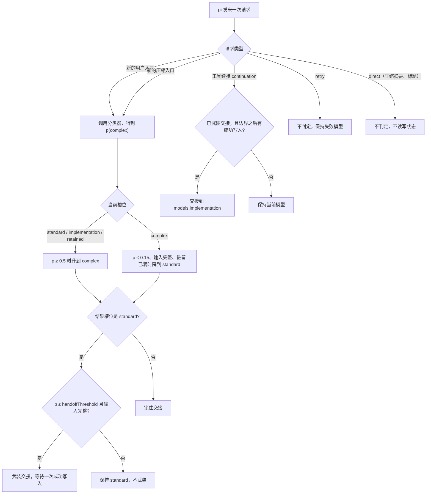

pi-jev-router 是 [pi](https://pi.dev) 的扩展。它注册一个虚拟模型 `jev/auto`，pi 每发一次请求，路由器就为这次请求挑一个物理模型：由强模型负责规划，另一档模型负责执行。

当前版本是 2.0.0。默认策略已经从 `fixed` 换成 `adaptive`，所以这篇文章的重点放在 `adaptive`：它在哪些边界判定，哪些情况一律不判定，判定结果要满足什么才真的换模型。

## 三个槽位

路由器只认三个槽位，槽位映射到哪个模型由配置决定，不从模型名、价格或上下文窗口反推能力。

| 槽位 | 默认模型 | 职责 |
| --- | --- | --- |
| `models.complex` | `openai-codex/gpt-6.1-sol` | 判定为复杂时的规划模型 |
| `models.standard` | `openai-codex/gpt-6.1-terra` | 其余情况的规划模型，也是分类不可用时的兜底 |
| `models.implementation` | `openai-codex/gpt-6-luna` | 交接之后的执行模型，设为 `null` 或 `false` 就关闭交接 |

除了 agent loop 里的请求，还有一类 `direct` 请求，例如压缩摘要和标题生成。它不走分类，也不读写路由状态，默认跟随 `models.implementation`，再退到 `models.standard`。

## 三条策略

策略决定路由器多久重新看一次输入。

| 策略 | 判定的时点 | 结果 |
| --- | --- | --- |
| `adaptive` | 每张新的用户入口、每张新的压缩入口 | 重新选复杂或普通槽位，条件满足时重新武装交接 |
| `fixed` | 只在第一张用户入口 | 第一次成功写入后换成执行模型，用到分支结束 |
| `record` | 路由与 `fixed` 相同 | 只把分类器本来会触发的升级记下来，不改实际路由 |

`fixed` 是可预测的：一次判定，一次交接，之后不再变。`adaptive` 把判定重新铺回会话里，代价是同一段工作可能在过程中换过模型。

## adaptive 只在两个边界判定

这是整个路由器的核心约束。分类器要花钱、有延迟、结果有抖动，所以它只在会话结构发生变化的地方被调用一次。



第一类边界是新的用户入口。路由器取投影里最后一张原始角色为 `user` 的条目，把它的可见文本连同最近的对话一起送给分类器。同一张用户入口只会被判定一次，判定过的 entry id 记在 `lastEvaluatedUserEntryId` 里，重开会话不会重判。

第二类边界是新的压缩入口。上下文被压缩之后，可见历史已经变了，所以当前分支上出现一个没处理过的 compaction entry 时，路由器会在下一次请求上再判一次。每个压缩 id 只判一次，而且压缩不增加驻留计数。

把判定点和刻意不判定的情况放在一张表里，边界更清楚。

| 请求 | 是否重新判定 | 原因 |
| --- | --- | --- |
| 新的原生用户入口 | 判一次，并记录 entry id | 难度可能变了 |
| 已判定过的用户入口 | 不判 | 同一输入不重复花钱 |
| 新的压缩入口 | 判一次，不计入驻留 | 可见上下文被改写 |
| 用户入口与压缩同时出现 | 只判一次 | 两者合成一次判定，压缩边界随之标记为已处理 |
| 工具续接 `continuation` | 不分类，只检查交接 | 同一轮工作，难度没有变 |
| `retry` | 不判、不交接、不消耗待定压缩 | 让失败的模型把话说完 |
| `direct` | 不判，不读写状态 | 不在 agent loop 里 |
| 分类超时、报错、没有分类器 | 不换模型 | 没有概率就不做决定 |

这些条件管的是不同的动作。分类器必须在 catalog 里可用，否则拿不到概率，什么都不变。`downgradeThreshold` 必须严格小于 `threshold`，否则 pi 启动就失败并报出配置路径。输入完整只约束两件事，降级和武装交接，条件是正文非空、没有图片、没有超过 `promptLimit`；升级和保持不需要它。

## 判定结果怎么变成模型

概率 `p` 是分类器给出的复杂度概率。边界判定是一张查表，槽位和概率区间共同决定结果。

| 当前槽位 | p ≥ `threshold` (0.5) | p ≤ `downgradeThreshold` (0.15) 且输入完整 | 落在两者之间 | 分类不可用 |
| --- | --- | --- | --- | --- |
| `complex` | 保持 `complex` | 驻留满 `minDwellTurns` 时降到 `standard`，否则保持 | 保持 | 保持 |
| `standard` | 升到 `complex` | 保持 | 保持 | 保持 |
| `implementation` | 升到 `complex` | 保持 | 保持 | 保持 |
| `retained`（模型被配置改动保留下来） | 升到 `complex` | 保持 | 保持 | 保持 |

只有 `complex` 能降级。降级要求当前输入完整，也就是没有图片、没有超长、没有空文本，因为残缺的输入更适合当成「没看清」，不适合当成「任务变简单」。升到 `complex` 还会检查目标模型是否还在 catalog 里，找不到就记一条 `target-missing` 并保持当前模型。

槽位一变，路由器做三件事：`turnsInSlot` 归零，`stageSeq` 加一，`stageStartEntryId` 指向当前叶节点。第三条是为了让交接证据有一个明确的起点，旧写入不会触发新阶段的交接。

## 交接要满足六件事

交接是唯一一次换到执行模型的动作，`adaptive` 默认策略是 `guarded`，要求下面这些条件同时成立。

| 条件 | 具体值 |
| --- | --- |
| 结果槽位是 `standard` | 选到 `complex` 就锁交接，不交接 |
| 概率有效且在保持区 | `p < 0.5` 且 `p ≤ adaptive.handoffThreshold`（0.2） |
| 输入与判定时一致 | 当前输入的 SHA-256 与 `handoffEvidence.inputKey` 相同 |
| 有写入证据 | 当前用户入口和 `stageStartEntryId` 之后出现成功写入，工具名在 `handoffTools` 里，默认 `edit` 和 `write` |
| 上下文还没失控 | `getContextUsage()` 返回的 token 数有限且不超过 `maxHandoffContextTokens`（50000） |
| 执行模型可用 | `models.implementation` 不为 `null`，且在 catalog 里，`handoffTools` 非空 |

证据不成立时路由器不是沉默地保持，而是写一条具体原因：`handoff-no-evidence`、`handoff-context-large`、`handoff-context-unknown`、`handoff-model-unavailable`。打开 `debug` 或在配置里开 `diagnostics.record` 就能看到这些值。

## 一次默认配置下的轨迹

下面是一个构造出来的会话，用来把上面的规则串起来。默认配置下 `threshold` 是 0.5，`downgradeThreshold` 是 0.15，`minDwellTurns` 是 2。

1. 新分支的第一条消息，`p = 0.82`，选到 `complex`，也就是 `gpt-6.1-sol`。槽位变化把驻留计数清零，交接锁住。
2. 用户继续追问，`p = 0.71`，保持 `complex`，驻留计数变成 1。
3. 用户问了一个收尾问题，`p = 0.09`，输入完整，驻留计数到 2，降到 `standard`，也就是 `gpt-6.1-terra`。这次结果在保持区里，交接被重新武装，证据记下当前输入的摘要。
4. 模型调 `edit`，嵌套调用状态是 `ok`。工具续接时路由器核对证据、上下文估计 18000 token，交接到 `gpt-6-luna`。
5. 用户再发一条新消息，`p = 0.31`，落在保持区，槽位是 `implementation`，保持不动。

如果第 4 步的写入先发生，用户再补一句话，然后才发起下一条请求，这次写入就落在旧边界之后、新边界之前，不再算数，路由器会按新消息重新判一次。这是有意的。交接只认当前用户入口和阶段锚点之后的写入，也必须对应到那次判定看过的输入。

## 设计取舍

### 判定点只有两个，且都在边界上

每次判定都要付一次分类延迟和一次外发，成本集中在判定的次数上。如果把分类挪到每条请求上，路由结果会更贴合当下，但会话里每一轮都要多等一次判定，还多了把输入发给第三方分类器的次数。选择边界判定，等于选择让路由器只在会话结构变化时说话。

代价是粒度粗。工具结果反而暴露了任务比判定时更复杂的时候，本轮不会因此重新分类，要等下一次用户消息或压缩。

### 0.15 到 0.5 之间什么都不做

单一阈值会让模型在概率跨线时反复横跳。所以阈值不止一个：`threshold` 是进入 `complex` 的门槛，`downgradeThreshold` 是离开 `complex` 的门槛，两者之间的区间是保持区。

这个区间比看上去重要。假设同一段输入两次判定得到 0.48 和 0.52，如果没有这段距离，一次措辞更客气的追问就能把强模型踢走，一次多问两句又能把它换回来。每一次换槽位都要重建阶段边界，交接证据也跟着作废。

`downgradeThreshold` 必须小于 `threshold`，这条约束写在配置校验里，不是文档里的建议。配置写反了，pi 启动直接失败。

### 降级还要等两个已评估的轮次

只靠概率不够。追问、确认、补一句「按这个来」，这类消息的文本往往很短，分类器容易判简单，但工作本身还在同一段复杂任务里。所以 `complex` 至少要服务 `minDwellTurns` 个已评估的用户轮次，才允许降级，升级那一轮不计入。

驻留计数只在新的用户入口上加一。压缩不增加计数，因为压缩是上下文的维护动作，不是工作推进。槽位一变，计数归零。

把降级做成「有延迟的、需要多轮的」判断，代价是遇到明显变简单的任务时会多花一两轮强模型的钱。换回来的是少一次来回横跳。

### complex 一被选中就锁交接

选到 `complex` 意味着这次任务值得用强模型。这里选择让 `complex` 同时负责规划和执行，把执行交给弱模型只在难度回落后发生。所以 `complex` 直接锁住交接，只有降回 `standard` 才会重新武装。

反过来也成立：降回 `standard` 表示难度已经回落，这时候重新武装交接，让执行交给更便宜的模型是合理的。交接跟着难度判断走，不跟着时间走，也不跟着「已经写了几个文件」走。

代价是会话早期一旦判成复杂，后面每一轮都留在强模型上，直到出现一次低概率、输入完整、驻留已满的判定。分支越长，这个代价越大。

另一头，一条分支可以升级和交接多次。早期版本限制过「一次升级、一次交接」，实现简单，但遇到长会话里反复切换难度的场景就不合适了。

### 交接要概率证据，不是要猜测

`guarded` 交接要求这次判定给出过一个有效概率，并且落在保持区里。有两个地方会因此不交接，两个都选择不猜。

一是分支刚开始就复用了上一个规划模型。复用省掉一次分类，但也就没有概率，没有概率就没有证据，于是 `guarded` 交接不成立。这里的选择是不猜：宁可少交接一次，也不要凭「看起来不难」把执行交给弱模型。想要老行为可以设 `adaptive.handoffPolicy: "first-write"`，代价是它在分类不可用时也会交接。

二是分类失败、超时、返回非法值。这三种情况都会保持当前模型，不降级、不升级，也不武装交接。

### 写入证据认两条路径，并且明确拒绝 bash

交接的证据是一次成功写入，判定留了两条路径：外层工具结果本身成功，也就是工具名在 `handoffTools` 里且 `isError` 为 false；或者嵌套调用里同名工具的状态是 `ok`。

嵌套 ok 就算数，哪怕外层工具最后失败，或者外层的记录不完整。这是刻意的，嵌套 ok 说明写入这件事已经发生了，它证明的是「执行开始了」，不是「任务完成了」。宿主不提供嵌套记录时，外层成功那条路径仍然有效。反过来，失败或未完成的嵌套调用不算，工具参数不算，模型在文字里说「我已经写好了」也不算。

`bash` 和 `codemode` 被配置校验拒绝放进 `handoffTools`。这两个工具能改文件，但无法区分「改了实现」和「顺手改了缓存或生成文件」，把它们当成交接信号只会让证据变模糊。自定义工具名可以写进去，前提是那个工具的成功确实意味着工作进入执行阶段，这个语义要自己担保。

### 价格不进判定

分类器只读文本，不读模型名，也不读价格。阈值不随价格漂移。

这不是因为省钱不重要，而是因为价格不适合当判定的输入。价格随供应商、缓存命中、时段和促销变化，把它放进判定，同一段文本在不同时间会路由到不同模型，事后很难解释某次请求为什么落到那个模型上。可解释性在这里比省钱幅度更有价值。

于是 `/jev-router usage` 的作用变成记账而不是决策：它报出分类调用次数、token 和已知成本，价格未知时明确显示未知，不把未知当零。分类调用自己也有 token 成本和延迟，只是没有进入判定。

### 历史有界，且不调用摘要模型

`adaptive` 的判定输入是当前用户文本加上最近若干完整轮次，默认最多 4 轮、8000 字符。超预算时按整轮丢弃，先丢最旧的；最新一轮单独超预算时历史为空，也不会拿更旧的一轮顶上。

历史预算和当前文本预算分开，`promptLimit` 管当前文本，`historyMaxTurns` 和 `historyCharLimit` 管历史。路由器不会为了塞进预算去调一个摘要模型，那等于让路由器自己变成一个 agent，多一次调用、多一份延迟，也把分类输入变成不可复现的二次加工。

历史不完整时会带上 `historyPartial` 标记，让判定结果能说明它的依据是不全的。

### retry 粘滞，状态放在分支上

重试不分类、不交接，也不消耗待定压缩。失败的模型还在的话，重试继续用它，连 thinking level 也沿用失败那次的。理由是重试要让同一个模型把没说完的话说完；如果重试也走一遍判定，一次瞬时失败就会变成一次新的路由决定，原来的状态反而说不清。

有一处例外是刻意留下的：重试仍然落在状态里的同一个模型时，交接状态和证据保留。这样一次瞬时失败不会让已经武装好的交接白白作废。换到别的模型才锁交接。

路由状态交给 pi 的分支机制保存，跟着会话树走，也跨压缩存活。代价是状态有版本：`adaptive-v3` 之前的 v1 和 v2 状态迁移时会锁住交接，已有的压缩标记为已处理。旧证据不凭空信任，宁可让分支少交接一次。

### `record` 先观察，再改默认

阈值和分类器概率的刻度是绑在一起的，换分类器、换模型、调 `classifier.temperature`，概率分布都会变。没人能凭直觉给定一个合适的 `threshold`。

`record` 就是为此存在的。路由和 `fixed` 完全一样：开头分类一次，第一次成功写入后交接到执行模型。区别只在后面，每当新的用户入口出现，而槽位不是 `complex` 时，它用 `adaptive` 会用的同一份输入再判一次，把「本来会升到哪个模型」写成 `proposedModel`，`applied` 是 false。它不报质量分，也不报成本差，只报这次判定本来会做什么。拿真实会话跑一段时间，看那条线落在哪里，再决定要不要改默认值或者切到 `adaptive`。

同一个思路解释了 2.0.0 的处理方式。`adaptive` 成了默认策略，老实说这是一次破坏性变更：不写 `strategy` 的配置文件，升级后会开始动态路由。因此版本号跳到 2.0.0，升级后第一次启动会做两件事，按版本只做一次：把最高优先级的配置文件里的非 `adaptive` 策略改写一次，并在没配置 provider、模型或分类器时提示去配置。用户自己改回 `fixed` 之后，不会再被覆盖。

## 安装与配置

```sh
pi install npm:@caph42/pi-jev-router
```

装好之后在 `/model` 里选 Auto (Jev)，或者用 `pi --model jev/auto` 启动。升级用 `pi update --extensions`。

默认配置不需要配置文件，一次 OpenAI Codex 登录就能看到三个默认模型。分类器需要 TypeSafe 凭据，没有的话 `adaptive` 拿不到概率，会停在 `models.standard` 且不交接。下面这份配置列出了想调的几个值：

```json
{
  "strategy": "adaptive",
  "threshold": 0.5,
  "adaptive": {
    "downgradeThreshold": 0.15,
    "minDwellTurns": 2,
    "handoffThreshold": 0.2,
    "handoffTools": ["edit", "write"],
    "handoffPolicy": "guarded",
    "maxHandoffContextTokens": 50000
  },
  "models": {
    "complex": "gpt-6.1-sol",
    "standard": "gpt-6.1-terra",
    "implementation": "gpt-6-luna"
  }
}
```

pi 只在启动时读配置，改完要重启。配置文件按 `$JEV_ROUTER_CONFIG`、`~/.pi/agent/jev-router.json`、`<项目>/.pi/jev-router.json` 的顺序合并，嵌套对象合并，数组整体替换，未知键告警后忽略。完整键表在仓库的 `jev-router.example.json` 和 README 里。

三个命令都不调用模型、不改状态。

```sh
/jev-router status        # 启动时读到的配置和实际读过的文件
/jev-router usage         # 当前分支的分类器用量
/jev-router usage --json  # 同一份摘要，JSON 形式
```

## 已知限制

- 分类器只读文本。一段很短的「继续」可能被判成简单，长粘贴的报错日志可能被判成复杂。
- 分类器自身有延迟和成本。默认每次判定最多等 3000 毫秒，超时的结果直接丢弃。用量记在 `/jev-router usage` 里，价格未知时显示未知。
- 判定只看文本复杂度，不看上一次执行得怎么样。路由器没有对任务结果做质量评估，也没有把测试结果、写入数量或模型自述当作能力信号。
- 阈值是按概率定的，换分类器或换模型要重新标定。`/jev-router status` 只报告启动时的配置，不报告当前路由，也不报告模型和分类器是否可用。
- thinking level 按物理模型在 pi 的 `settings.json` 里配置，没有 per-slot 字段。两个槽位指向同一个物理模型时，无法通过 `modelThinkingLevels` 为它们分别设置思考强度，升级对这次请求就没有可见影响。
- 三个槽位共用一个 `provider` 字段，跨 provider 的槽位还没有对应的配置项。

仓库里有 313 项测试，其中 305 项通过，8 项宿主测试默认跳过，设置 `PI_ROUTER_HOST_MODULE` 指向本机 pi 的公共入口才会运行。测试针对的是公开的 `route` 行为，不是内部函数。
